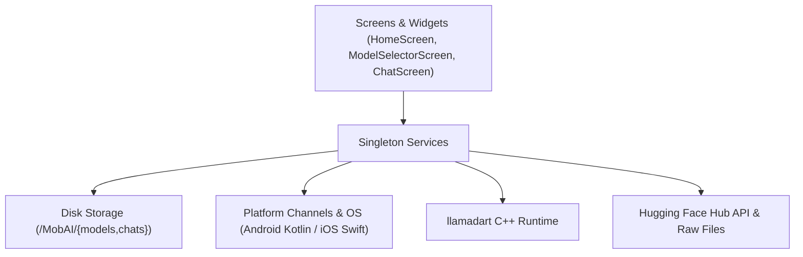

# MobAI Technical Architecture

This document explains how **MobAI** structures state, Hugging Face catalog resolution, resumable downloads, native platform bridges, and local LLM execution on **Android** and **iOS**.

---

## 1. Layered Architecture

### App Startup ([lib/main.dart](../lib/main.dart))
1. Registers `ModelManagerService.onBeforeDeleteModel` so deleting a downloaded `.gguf` unloads it from `LocalInferenceService` first.
2. Initializes `StorageService` (resolving `<root>/MobAI` and loading saved Hugging Face Bearer tokens).
3. Runs `ModelManagerService.syncWithStorage()` to reconcile `models_index.json`, scan unmanaged `.gguf` files, restore paused downloads from `downloads_state.json`, and query physical RAM (`getDeviceRamGb`).
4. Initializes `DownloadNotificationService` listeners for native notification actions (`pause`, `resume`, `cancel`, `open_downloads`, `force_close`) and `AppLifecycleState.detached` teardown flushing.
5. Loads persisted chat sessions via `ChatSessionService.loadSessionsFromStorage()`.

---

## 2. Storage & Persistence (`StorageService`)

Implemented in [storage_service.dart](../lib/services/storage_service.dart):

- **Directory Normalization (`normalizeMobaiRoot`):** Prevents nested `MobAI/MobAI` directories when users pick an existing `MobAI` folder.
- **Android SAF URI Handling (`resolveDirectoryUri`):** Translates `content://.../tree/primary:...` directory URIs into writable filesystem paths under `/storage/emulated/0/...` and probes write access before applying.
- **Migration (`setStorageRoot`):** Optionally moves existing `models/` and `chats/` contents to the newly chosen root.
- **Chat Writes (`ChatSessionService`):** Per-session JSON saves (`MobAI/chats/<sessionId>.json`) are serialized sequentially per `sessionId` via `_saveQueues` to avoid concurrent file corruption during token streaming.

---

## 3. Hugging Face Catalog & Metadata Resolution

Implemented across [model_catalog_service.dart](../lib/services/model_catalog_service.dart), [open_model.dart](../lib/models/open_model.dart), and [model_manager_service.dart](../lib/services/model_manager_service.dart):

1. **List Query (`expand[]` vs `full=true`):**
   Hugging Face `/api/models?filter=gguf&full=true` omits `gguf` metadata and `siblings[].size`. MobAI requests explicit `expand[]` parameters (`author`, `baseModels`, `cardData`, `createdAt`, `downloads`, `gated`, `gguf`, `likes`, `safetensors`, `siblings`, `tags`) with `ListFormat.multi`, `pipeline_tag=text-generation`, and RFC 5988 `Link` cursor pagination (`loadMoreModels`).
2. **Initial Size & Parameter Accuracy:**
   `OpenModel.fromHuggingFace` resolves parameter counts from `safetensors['total']`, then `gguf['total']`, before falling back to repo-slug parsing. Before exact byte sizes arrive, `estimatedMbPerBillionParams(quantization)` and `gguf['totalFileSize']` compute realistic sizes (up to `2000000` MB) so massive desktop models immediately trigger `"Not recommended"` badges.
3. **Lazy Repository Enrichment:**
   After catalog pages load, `ModelManagerService._scheduleCatalogSizeEnrichment` runs a bounded 4-worker pool fetching:
   - `/api/models/<repoId>?blobs=true` (when `!model.hasExactSizes`) to fill exact variant and split-shard byte sizes.
   - `/<repoId>/raw/main/README.md` (when `!model.hasFetchedDescription`), stripped cleanly of YAML frontmatter, HTML badge markup, and Markdown syntax via `ModelCatalogService.parseReadmeDescription`.
   Opening the variant sheet (`getVariantsForModel`) or model details dialog (`ensureDescriptionLoaded`) resolves any uncached model on demand.
4. **Custom URLs & Gated Auth:**
   [hf_url_parser.dart](../lib/services/hf_url_parser.dart) normalizes HF repo URLs, `/blob/` links to `/resolve/`, and `hf://` URIs. `Authorization: Bearer <hfToken>` headers are attached only when `StorageService.isHuggingFaceHost(url)` evaluates true.

---

## 4. Resumable & Background Download Pipeline

Implemented in [model_manager_service.dart](../lib/services/model_manager_service.dart):

- **Buffered Streaming:** Streams HTTP bodies via `Dio` (`ResponseType.stream`) through a `1 MB` `BytesBuilder` buffer and throttles progress/notification updates to `~1000 ms`.
- **HTTP Range Resume:** Checks existing `<file>.part` byte length on disk and sends `Range: bytes=<offset>-`:
  - `206 Partial Content`: Appends cleanly from offset.
  - `200 OK`: Resets `.part` and restarts from byte 0.
  - `416 Range Not Satisfiable`: Validates completed byte offset against `Content-Range` (and GGUF header for Part 1) or cleans up and restarts cleanly.
- **HTML / Auth Guards:** Rejects `text/html` payloads (such as HF gated login pages) and cleans `.part` artifacts; flags HTTP `401`/`403` with `isGatedError` so UI offers token entry or ungated search.
- **Split-GGUF Shards (`-00001-of-0000N.gguf`):**
  - `OpenModel.parseSplitShard` groups shards into a single logical `GgufVariant` with summed byte sizes (single-file variants sorted ahead of split variants).
  - Downloads parts `1..N` sequentially. Only Part 1 (`partIdx == 0`) validates the 4-byte `GGUF` magic header (`0x47 0x47 0x55 0x46`); shards `2..N` are raw tensor chunks.
  - Canceling or deleting removes every shard `.part` and final `.gguf` file on disk.
- **Lifecycle Continuity:** Downloads continue across navigation (`HomeScreen` `PopScope` calls `moveToBackground()`), search/sort/filter updates, and app backgrounding. `pauseAllActiveDownloads()` flushes `.part` buffers and `downloads_state.json` only on explicit pause/cancel or app termination (`AppLifecycleState.detached` / Android `onTaskRemoved`).

---

## 5. Native Platform Bridges (`Android` & `iOS`)

Both platforms share channel `"com.example.mobai/download_notifications"` ([download_notification_service.dart](../lib/services/download_notification_service.dart)):

| Method / Feature | Android ([MainActivity.kt](../android/app/src/main/kotlin/com/example/mobai/MainActivity.kt)) | iOS ([AppDelegate.swift](../ios/Runner/AppDelegate.swift)) |
| :--- | :--- | :--- |
| `syncDownloadNotifications` | Launches/updates `DownloadForegroundService` (`dataSync`), WakeLock/WifiLock & `Pause`/`Resume`/`Cancel` broadcasts | Safe no-op |
| `cancelDownloadNotification` | Removes notification & stops foreground service when queue empties | Safe no-op |
| `moveToBackground` | Calls `moveTaskToBack(true)` | Safe no-op |
| `getDeviceRamMb` | Reads `ActivityManager.MemoryInfo.totalMem` | Reads `ProcessInfo.processInfo.physicalMemory` |
| `openUrl` | Launches `Intent.ACTION_VIEW` for `http`/`https` | Calls `UIApplication.shared.open` |
| EventChannel actions | `pause`, `resume`, `cancel`, `open_downloads`, `force_close` via `DownloadNotificationBridge` | — |

---

## 6. Inference Engine (`LocalInferenceService`)

Implemented in [local_inference_service.dart](../lib/services/local_inference_service.dart):

- **Pre-load Guards:** Verifies file existence, rejects auxiliary weights (`mmproj`, `mtp`, `draft`), refuses direct loading of split shard `> 1`, and confirms all `1..N` sibling shards exist in the same directory.
- **Single-Model Policy:** Unloads any active `LlamaEngine` model before loading a new file.
- **Context Creation Recovery:** Attempts default engine configuration first (`GpuBackend`); if loading fails, unloads and retries on `ComputeDevice.cpu` with `gpuLayers: 0` and `contextSize: 1024`.

---

## 7. Filtering & Catalog State

- **Single Source of Truth:** [model_filter_criteria.dart](../lib/models/model_filter_criteria.dart) stores size/params/RAM ranges, selected creators, `hideNotRecommended`, and `downloadedOnly`. `downloadedOnly` is synchronized between the `All` / `My Models` quick chips and `ModelFilterBottomSheet`.
- **Two-Way Slider Inputs:** [model_filter_bottom_sheet.dart](../lib/screens/widgets/model_filter_bottom_sheet.dart) keeps Download Size (`GB`), Parameters (`B`), and Minimum RAM (`GB`) `RangeSlider`s synced with numeric Min/Max `TextField`s and a searchable creator checkbox list.

---

## 8. Testing & Verification

- **Loopback Integration Mocks:** Download, pagination, HF auth, split-shard, and README enrichment tests run against ephemeral `dart:io` `HttpServer` instances instead of live network calls.
- **`@visibleForTesting` Hooks:** `StorageService.initForTesting`, `ModelManagerService.configureForTesting` (`enableBackgroundEnrichment = false` by default for deterministic tests), and `ChatSessionService.configureForTesting` (with `inferenceOverride` streaming).
- **Suite Coverage:** `11` test files (`56` automated tests) under `test/` covering storage, persistence, filters, URL parsing, pause/resume downloads, split shards, notifications UI, and catalog screens.
